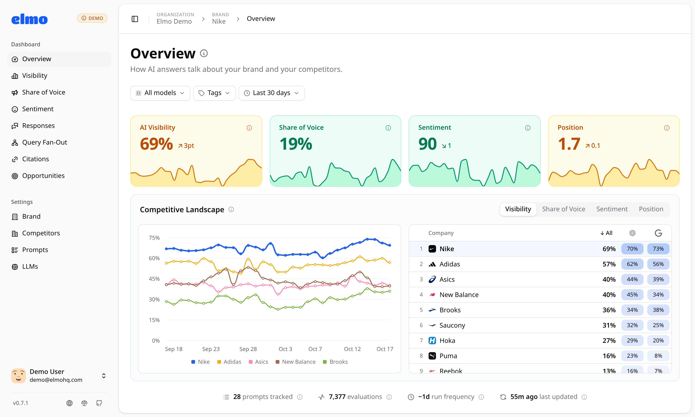
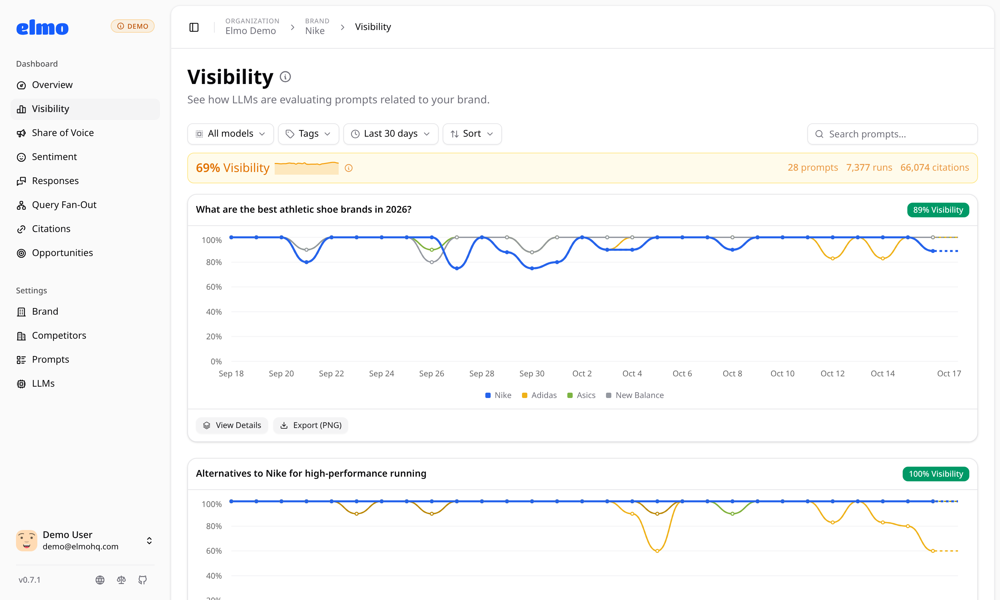
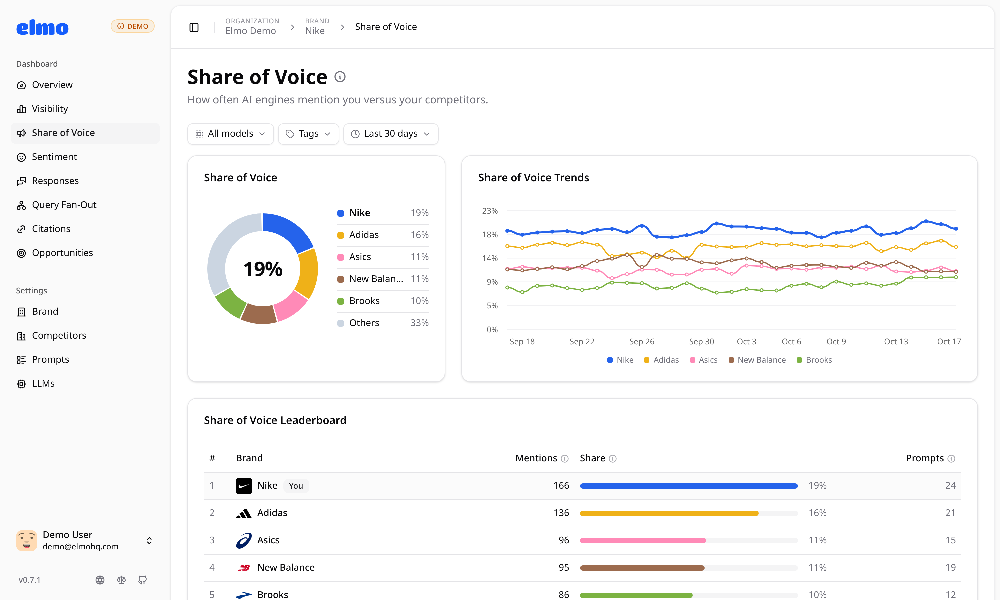
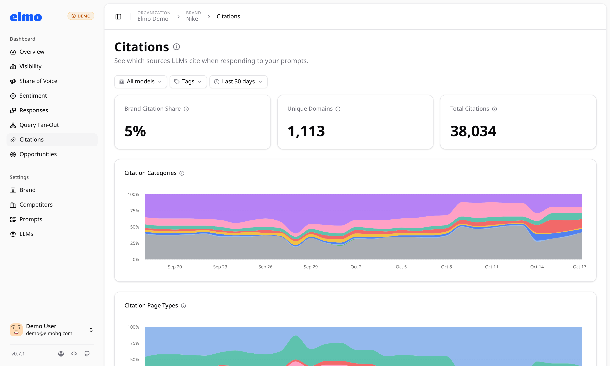
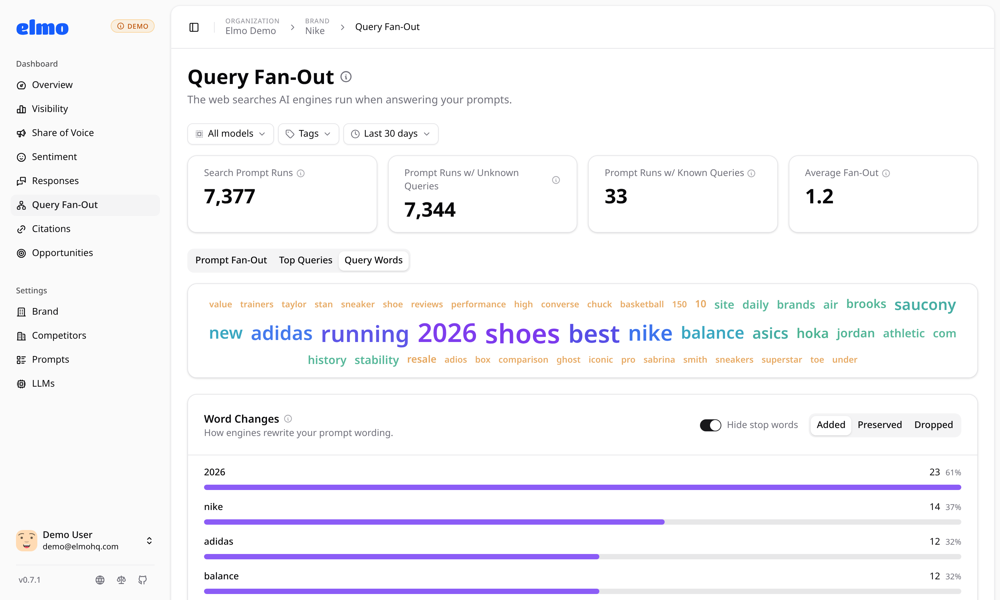
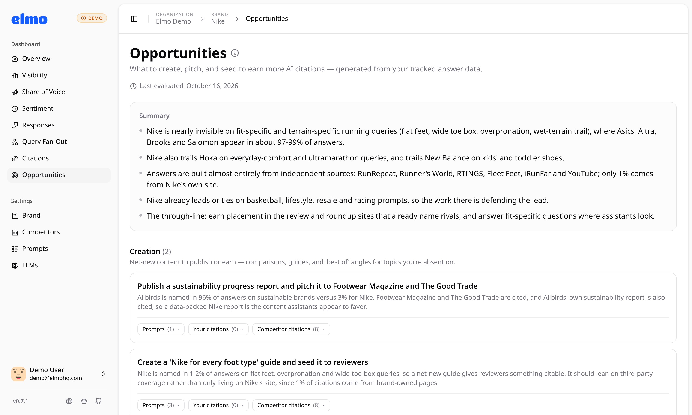
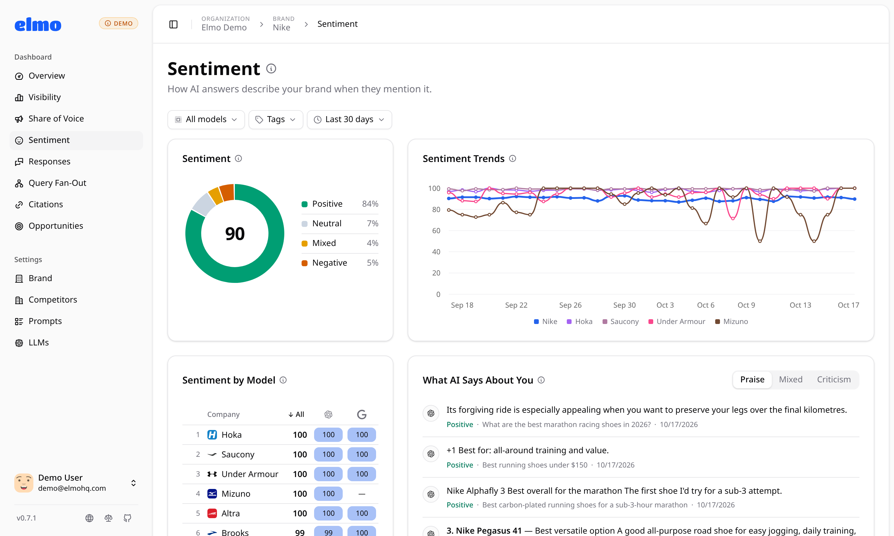
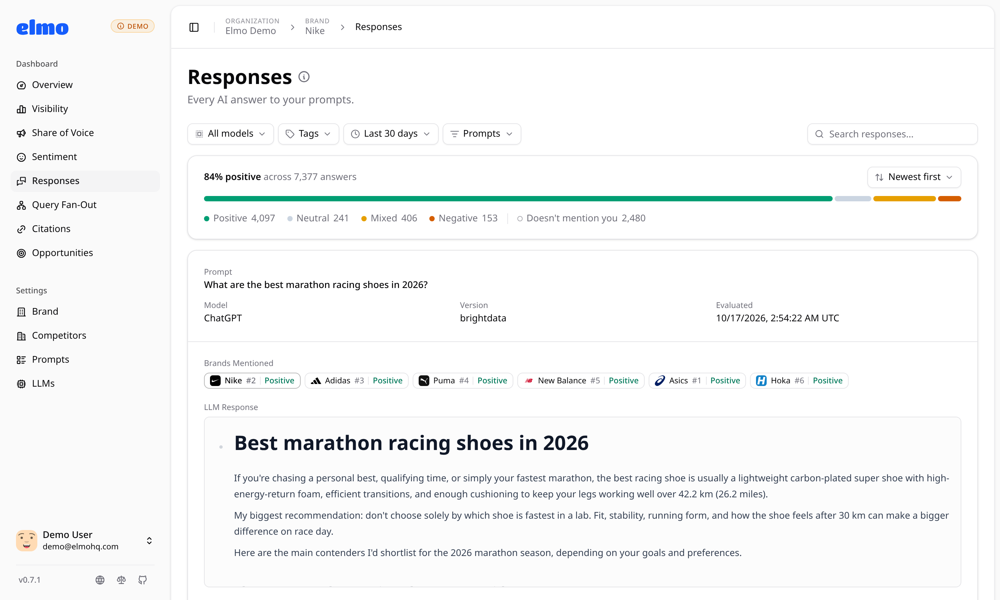
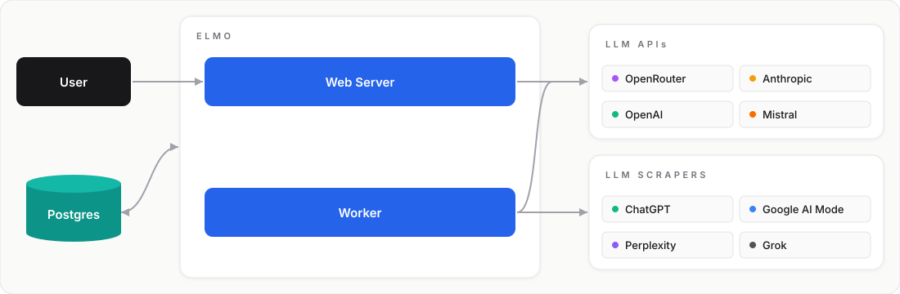

<p align="center">
  <a href="https://www.elmohq.com/">
    
  </a>
</p>

<p align="center">
  Open source AI visibility tracking and optimization.
  <br />
  <br />
  <a href="https://www.elmohq.com/"><strong>Learn more »</strong></a>
</p>

<br />

<p align="center">
  <a href="https://www.elmohq.com/docs"></a>&nbsp;
  <a href="https://demo.elmohq.com"></a>&nbsp;
  <a href="https://github.com/elmohq/elmo/issues"></a>&nbsp;
  <a href="https://github.com/orgs/elmohq/projects/3/views/1"></a>&nbsp;
  <a href="https://discord.gg/s24nubCtKz"></a>
</p>

<br />

## About

Elmo is an open-source, self-hosted platform for optimizing your AI visibility, which is also known as:
* Answer Engine Optimization (AEO)
* Generative Engine Optimization (GEO)
* LLM Optimization (LLMO, which is where the name Elmo is from)

Elmo tracks how AI answer engines like ChatGPT, Claude, Perplexity, Gemini, and Google AI Overviews mention, cite, and describe your brand, so you can benchmark competitors and grow your visibility in AI answers.

It's a free alternative to tools like [Profound](https://www.elmohq.com/ai-visibility-tools/elmo-vs-profound), [Peec](https://www.elmohq.com/ai-visibility-tools/elmo-vs-peec-ai), and [Otterly](https://www.elmohq.com/ai-visibility-tools/elmo-vs-otterly-ai). You can run it on your own infrastructure, own your data, and audit exactly how every metric is calculated.

## Demo

Try the live demo at **[demo.elmohq.com](https://demo.elmohq.com)** to see how Elmo tracks prompts and analyzes citations.

## Screenshots

| Dashboard overview | Visibility tracking |
|---|---|
|  |  |
| **Share of voice** | **Citation analysis** |
|  |  |
| **Query fan-out** | **Opportunities** |
|  |  |
| **Sentiment** | **Responses** |
|  |  |

## What Elmo Tracks

- **Visibility scoring** — For every tracked prompt, Elmo measures how often each AI answer engine mentions your brand and trends the score over time, per prompt and per model.
- **Brand mention tracking** — Each answer is checked for your brand name, aliases, and domains, so mentions are counted the same way every time, across every engine.
- **Sentiment and position** — Every answer that names your brand or a competitor is read for its sentiment toward that company (positive, neutral, mixed, or negative) and where it ranks among the tracked companies named. Sentiment rolls up into a 0–100 score per prompt, per model, and against each competitor, with the exact passages behind it.
- **Responses** — Search every AI answer for your brand, filter by model, tag, prompt, or sentiment, and click a company's badge to highlight the passage its sentiment was read from.
- **Citation analysis** — Every URL an engine cites is stored with its domain and position, then categorized: your own domains, competitor domains, social media, Google properties, and institutional sources. You see which pages AI models actually trust for your industry.
- **Competitor benchmarking and share of voice** — A leaderboard of competitor mention rates next to your own, with your overall share of voice and how it moves over time.
- **Query fan-out analysis** — When an answer engine grounds a response, it often runs several web searches first. Elmo records those searches, shows how engines rewrite your wording (which words they add, drop, or keep), and which searches your content wins or misses.
- **Prompt management** — An onboarding wizard analyzes your website, then suggests keywords, competitors, buyer personas, and tracking prompts. You can also add prompts manually, tag them, and enable or disable them individually.
- **Opportunities** — Elmo turns your tracked visibility and citation data into a prioritized, regularly refreshed list of what to create, pitch, and seed to earn more AI citations.
- **Reports** — Shareable AI visibility reports (visibility summary, per-prompt breakdown, citation analysis, competitor comparison) viewable by stakeholders without an Elmo account.
- **API, SDKs, and MCP** — A REST API (with TypeScript and Python SDKs) for brands, prompts, competitors, analytics, sentiment, citations, runs, opportunities, and reports, plus an MCP server so Claude Code, Cursor, Codex, and VS Code can query your data and manage prompts. See the [API reference](https://www.elmohq.com/docs/api) and [MCP docs](https://www.elmohq.com/docs/api/mcp).

## How Elmo Measures AI Visibility

Elmo's methodology is simple and fully inspectable in this repository:

1. **Prompts are defined per brand** — either generated by the onboarding wizard from your website or written by hand. Each prompt is a question a potential customer might ask an AI assistant.
2. **A background worker runs each prompt on a schedule** (several times a day by default) against every engine you configure. Scraping providers capture the real consumer surfaces — ChatGPT, Google AI Mode, Google AI Overviews, Gemini, Perplexity, and Microsoft Copilot — while direct model APIs (OpenAI, Anthropic, Mistral, OpenRouter) add coverage for Claude, Grok, and other models with web search enabled. The [providers guide](https://www.elmohq.com/docs/user-guide/providers) compares both approaches and their costs.
3. **Every answer is normalized and parsed.** Each run produces the answer text, the list of cited URLs, the web searches the engine ran while grounding (its query fan-out), and the model version. The text is scanned for your brand's name, aliases, and domains, and for each competitor's, and [Jev](https://typesafe.ai) reads each answer that names one to decide whether it really means that company, its sentiment toward it, and the passage that shows it.
4. **Everything is stored in PostgreSQL**, including the raw engine output, so any metric can be re-derived and audited later. Nothing is a black box: the mention detection, scoring, and aggregation code is all in this repo, and every judgment keeps the passage it rests on.
5. **Metrics are aggregated into trends.** Visibility is the share of runs that mention your brand; share of voice compares your mention rate against competitors; sentiment scores positive answers 100, neutral and mixed 50, and negative 0; position averages where you rank among the tracked companies an answer names; citation counts roll up by URL, domain, and category — each filterable by prompt, tag, engine, and time range.

Because Elmo is open source, this loop is the part you never have to take on faith. Answer Engine Optimization (AEO) tooling lives or dies on measurement quality, and Elmo's measurements are ones you can read, run, and verify.

## Elmo vs. Closed-Source Alternatives

Most AI visibility platforms are closed SaaS. Here is how Elmo compares to the widely used ones:

| Tool | Open source | Self-hostable | Auditable metrics | Data ownership | Pricing model | Engine coverage |
|---|---|---|---|---|---|---|
| [**Elmo**](https://www.elmohq.com/) | Yes (MIT) | Yes (Docker Compose) | Yes — scoring code is public | Yours — your own PostgreSQL | Free self-hosted; cloud from $29/mo | ChatGPT, Google AI Mode, Google AI Overviews, Gemini, Perplexity, Copilot, Claude, Grok, Mistral, and more |
| [Profound](https://www.elmohq.com/ai-visibility-tools/elmo-vs-profound) | No | No | No — proprietary scoring | Vendor-hosted | Enterprise, custom pricing | Multiple engines, plus AI crawler analytics |
| [Peec AI](https://www.elmohq.com/ai-visibility-tools/elmo-vs-peec-ai) | No | No | No | Vendor-hosted | Paid subscription, custom pricing | Multiple engines |
| [Otterly AI](https://www.elmohq.com/ai-visibility-tools/elmo-vs-otterly-ai) | No | No | No | Vendor-hosted | Paid subscription, custom pricing | Multiple engines, plus on-page GEO audits |
| [Scrunch](https://www.elmohq.com/ai-visibility-tools/elmo-vs-scrunch) | No | No | No | Vendor-hosted | Enterprise, custom pricing | Multiple engines; content-optimization focus |
| [Ahrefs Brand Radar](https://www.elmohq.com/ai-visibility-tools/elmo-vs-ahrefs-brand-radar) | No | No | No | Vendor-hosted | From $129/mo | Multiple engines, tied to Ahrefs' SEO dataset |
| [Semrush AI Toolkit](https://www.elmohq.com/ai-visibility-tools/elmo-vs-semrush-ai-toolkit) | No | No | No | Vendor-hosted | From $139.95/mo | Multiple engines, tied to Semrush's SEO platform |
| [HubSpot AEO Grader](https://www.elmohq.com/ai-visibility-tools/elmo-vs-hubspot-aeo-grader) | No | No | No | Vendor-hosted | Free | One-time website audit, not continuous tracking |

To be fair about where the closed tools are genuinely ahead: Profound, Peec AI, Ahrefs, and Semrush offer prompt volume estimates; Profound, Otterly, and Scrunch analyze AI crawler behavior; Otterly, Scrunch, and HubSpot audit and optimize on-page content; and Ahrefs and Semrush integrate AI tracking with established SEO datasets. Elmo doesn't do those things today — see the [roadmap](https://www.elmohq.com/roadmap) for what's planned. What none of them offer is the ability to read the code behind every number, run it on your own infrastructure, and keep the data.

Elmo also maintains a directory of 100+ Answer Engine Optimization and Generative Engine Optimization tools with feature matrices and head-to-head comparisons: [AI Visibility Tool Directory](https://www.elmohq.com/ai-visibility-tools).

## Who Elmo Is For

- **Self-hosting teams** who want AI visibility data inside their own infrastructure — your prompts, your competitors, and every raw engine response stay in a PostgreSQL database you control.
- **Agencies** offering Answer Engine Optimization to clients: the white-label deployment adds custom branding, a custom domain, and SSO on top of multi-brand tracking.
- **Developers and analysts** who want auditable metrics — a REST API with TypeScript and Python SDKs, an MCP server for AI assistants, a documented methodology, and a database you can query directly instead of a dashboard-only black box.
- **Anyone priced out of enterprise AEO platforms** who still needs credible measurement of how ChatGPT, Perplexity, Gemini, and Google AI Overviews talk about their brand.

## Quick Start

> [!TIP]
> **Would rather not self-host?** Elmo Cloud runs the same open-source platform for you, with managed hosting and automatic updates, from $29/mo. [Start with Cloud →](https://www.elmohq.com/pricing)

For local deployments, use Docker Compose as configured with the `@elmohq/cli` package:

```bash
# Install the CLI globally
npm install -g @elmohq/cli

# Initialize configuration (interactive wizard)
elmo init

# Start the stack
elmo compose up -d
```

You'll need API keys for at least one AI provider or scraper, plus a [TypeSafe](https://console.typesafe.ai) key for Jev, which judges mentions and sentiment (or an OpenRouter key, to call Jev through OpenRouter). Jev costs very roughly $0.15–0.35 per 1,000 answers: about $2–4 a month for 25 prompts on 3 platforms, or $11–26 for 100 prompts on 5. See [mention judging](https://www.elmohq.com/docs/developer-guide/configuration#mention-judging).

Once the services report healthy, open **http://localhost:1515** and create your account. The full walkthrough is in the [getting started guide](https://www.elmohq.com/docs/getting-started).

> [!TIP]
> **Watch** this repo's **releases** to get notified of major updates.

## Skill

The [`aeo` skill](skills/aeo/SKILL.md) teaches Claude Code, Cursor, Codex, and other coding agents an evidence-based answer engine optimization workflow: measure, diagnose, fix, then measure again. It works with or without Elmo, and it can read Elmo's data over MCP.

```bash
npx skills add elmohq/elmo
```

Or copy [`skills/aeo`](skills/aeo) into your agent's skills directory (for Claude Code, `~/.claude/skills/aeo`). On claude.ai, zip the `aeo` folder and upload it in the Skills settings.

## Deployment Options

| Option | What you get | Price |
|---|---|---|
| **Self-hosted** | The full platform on your own infrastructure via Docker Compose, unlimited prompts, every supported engine and provider | Free (MIT) |
| **Elmo Cloud** | Managed hosting with automatic updates, unlimited seats, and API access on every plan | From $29/mo |
| **White-label** | Everything in Cloud plus custom branding, a custom domain, and SSO — built for agencies serving multiple clients | Custom |

Details and plan limits are on the [pricing page](https://www.elmohq.com/pricing).

## Architecture

<p align="center">
  
</p>

A web app serves the dashboard and REST API, a worker schedules and executes prompt runs against the AI engines, and PostgreSQL stores both the data and the job queue. The [developer guide](https://www.elmohq.com/docs/developer-guide) covers the monorepo layout and how to contribute.

## Tech Stack

- [Docker Compose](https://docs.docker.com/compose/)
- [PostgreSQL](https://www.postgresql.org/)
- [TypeScript](https://www.typescriptlang.org/)
- [TanStack Start](https://tanstack.com/start/latest)
- [pg-boss](https://github.com/timgit/pg-boss)

## Documentation

- [Getting started](https://www.elmohq.com/docs/getting-started) — self-host Elmo in under five minutes
- [User guide](https://www.elmohq.com/docs/user-guide) — brand setup, prompts, visibility, sentiment, citations, and reports
- [Providers](https://www.elmohq.com/docs/user-guide/providers) — choosing scrapers and model APIs for each answer engine
- [Developer guide](https://www.elmohq.com/docs/developer-guide) — architecture, configuration, and contributing
- [API reference](https://www.elmohq.com/docs/api) — the REST API, TypeScript and Python SDKs, and MCP server
- [AI Visibility Tool Directory](https://www.elmohq.com/ai-visibility-tools) — 100+ AEO/GEO tools compared

## Sponsors

<p align="left">
  <a href="https://www.searchapi.io/?utm_source=github&utm_medium=sponsorship&utm_campaign=google_search_api&utm_content=elmohq_elmo"></a>
  <a href="https://www.llumohq.com/?ref=elmo"></a>
</p>

<a href="https://github.com/sponsors/elmohq"><strong>Become a sponsor →</strong></a>

## Contact

- [Discord](https://discord.gg/s24nubCtKz)
- [Email](mailto:support@elmohq.com)
- [Schedule a call](https://www.elmohq.com/demo)

## Contributing

Interested in contributing? See [CONTRIBUTING.md](CONTRIBUTING.md) for the contribution workflow and CLA process, the [developer guide](https://www.elmohq.com/docs/developer-guide) for setup and architecture, and browse [good first issues](https://github.com/elmohq/elmo/issues?q=is%3Aissue+is%3Aopen+label%3A%22good+first+issue%22) to get started.

## License

Elmo is open source under the [MIT License](LICENSE.md).

## Repo Activity


