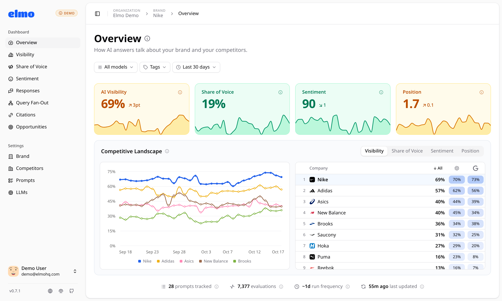
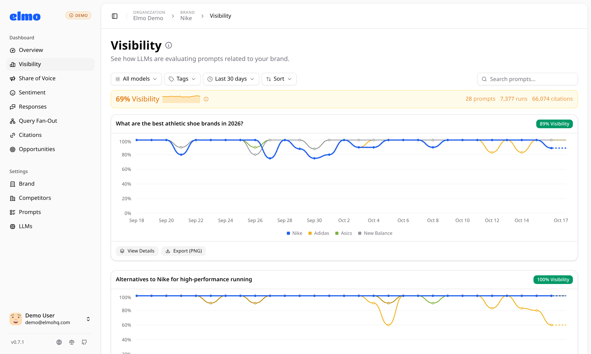
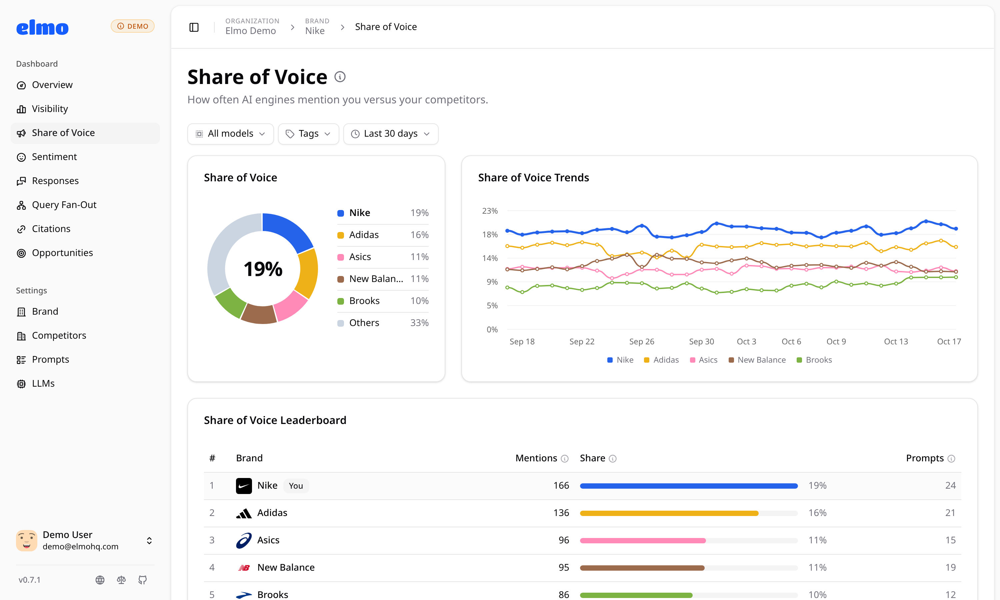
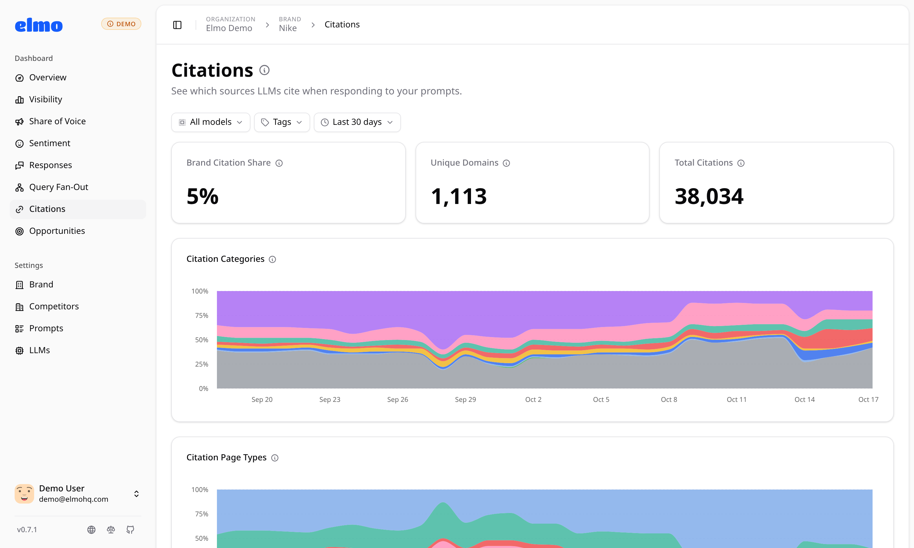
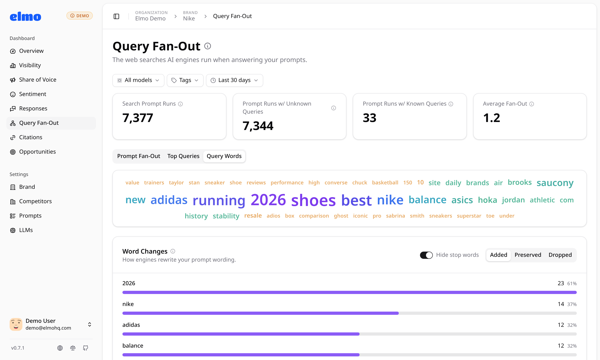
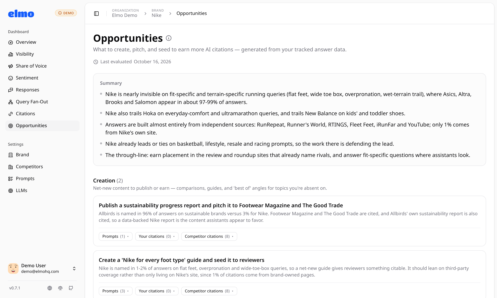
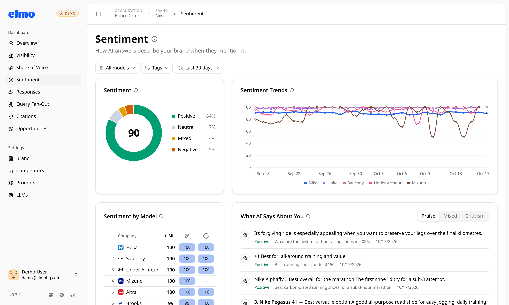
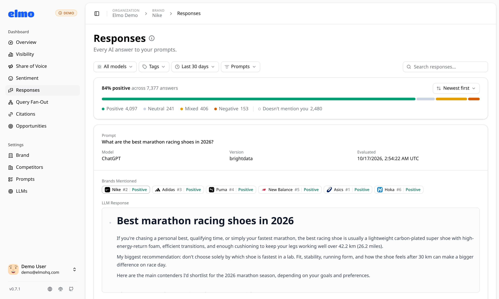
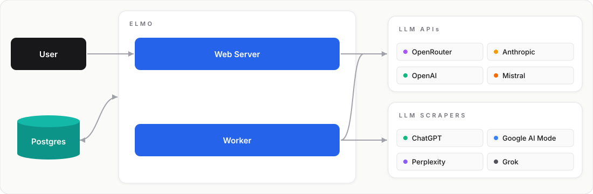

<p align="center">
  <a href="https://www.elmohq.com/">
    
  </a>
</p>

<p align="center">
  Open source AI visibility tracking and optimization.
  <br />
  <br />
  <a href="https://www.elmohq.com/"><strong>Learn more »</strong></a>
</p>

<br />

<p align="center">
  <a href="https://www.elmohq.com/docs"></a>&nbsp;
  <a href="https://demo.elmohq.com"></a>&nbsp;
  <a href="https://github.com/elmohq/elmo/issues"></a>&nbsp;
  <a href="https://github.com/orgs/elmohq/projects/3/views/1"></a>&nbsp;
  <a href="https://discord.gg/s24nubCtKz"></a>
</p>

<br />

> [!TIP]
> **Don't want to self-host?** Elmo Cloud runs the same open-source platform for you, with managed hosting and automatic updates, from $29/mo. [Start with Cloud →](https://www.elmohq.com/pricing)

## About

Elmo is an open-source, self-hosted platform for optimizing your AI visibility, which is also known as:
* Answer Engine Optimization (AEO)
* Generative Engine Optimization (GEO)
* LLM Optimization (LLMO, which is where the name Elmo is from)

Buyers increasingly ask AI before they search or visit a website. Elmo tracks how AI answer engines like ChatGPT, Claude, Perplexity, Gemini, and Google AI Overviews mention, cite, and describe your brand, so you can benchmark competitors, uncover citation gaps, and win more recommendations in AI answers.

It's an open-source alternative to tools like [Profound](https://www.elmohq.com/ai-visibility-tools/elmo-vs-profound), [Peec](https://www.elmohq.com/ai-visibility-tools/elmo-vs-peec-ai), and [Otterly](https://www.elmohq.com/ai-visibility-tools/elmo-vs-otterly-ai). You can run it on your own infrastructure, own your data, and audit exactly how every metric is calculated.

## Demo

Try the live demo at **[demo.elmohq.com](https://demo.elmohq.com)** to see how Elmo tracks prompts and analyzes citations.

## Screenshots

| Dashboard Overview | Visibility Tracking |
|---|---|
|  |  |
| **Share of Voice** | **Citation Analysis** |
|  |  |
| **Query Fan-Out** | **Opportunities** |
|  |  |
| **Sentiment** | **Responses** |
|  |  |

## What Elmo Tracks

- **[Visibility](https://www.elmohq.com/features/ai-visibility-tracking)** — how often each AI engine mentions your brand for every tracked prompt, per prompt and per model, trended over time. Mentions are matched on your name, aliases, and domains, then confirmed by a judge model.
- **[Share of voice](https://www.elmohq.com/features/share-of-voice)** — a competitor leaderboard and how your share of mentions moves over time.
- **[Sentiment and position](https://www.elmohq.com/features/sentiment-analysis)** — whether each answer is positive, neutral, mixed, or negative toward you and each competitor, where you rank among the companies named, and the exact passage behind every judgment.
- **[Citations](https://www.elmohq.com/features/citation-tracking)** — every URL an engine cites, grouped by domain and category (yours, competitors', social, Google, institutional), so you know which pages AI trusts in your category.
- **[Query fan-out](https://www.elmohq.com/features/query-fan-out)** — the web searches engines run before answering, how they rewrite your prompts, and which searches your content wins or misses.
- **[Prompt tracking](https://www.elmohq.com/features/prompt-tracking)** — an onboarding wizard that suggests prompts, competitors, and personas from your website, plus manual prompts and tags.
- **[Opportunities](https://www.elmohq.com/features/aeo-recommendations)** — a prioritized list of what to create, pitch, and seed to earn more AI citations.
- **[Reports](https://www.elmohq.com/features/ai-visibility-reporting)** — shareable visibility reports stakeholders can open without an Elmo account.
- **[API, SDKs, and MCP](https://www.elmohq.com/features/api-and-mcp)** — a REST API with TypeScript and Python SDKs, and an MCP server for Claude Code, Cursor, Codex, and VS Code.

## How Elmo Measures AI Visibility

1. **Prompts** — the questions your buyers ask AI, generated from your website or written by hand.
2. **Runs** — a worker runs every prompt several times a day on each engine you track. [Multi-engine tracking](https://www.elmohq.com/features/multi-engine-tracking) scrapes the real consumer apps (ChatGPT, Google AI Mode, Google AI Overviews, Gemini, Bing AI Mode) and calls model APIs for Claude, Perplexity, Grok, and others; the [providers guide](https://www.elmohq.com/docs/user-guide/providers) compares the options.
3. **Analysis** — each answer is stored raw in PostgreSQL with its citations and fan-out searches, then [Jev](https://typesafe.ai) judges which companies it really mentions, the sentiment toward each, and the passage that shows it.
4. **Metrics** — visibility is the share of runs that mention you; sentiment scores positive 100, neutral and mixed 50, negative 0; position averages your rank among companies named. Everything filters by prompt, tag, engine, and date.

Every step is code in this repo, and every number can be re-derived from the raw answers it came from.

## Elmo vs. Closed-Source Alternatives

Most AI visibility platforms are closed SaaS. Here is how Elmo compares to the widely used ones:

| Tool | Open Source | Auditable Metrics | Self-Hosted | Cloud |
|---|---|---|---|---|
| [**Elmo**](https://www.elmohq.com/) | Yes (MIT) | Yes | Free | From $29/mo |
| [Profound](https://www.elmohq.com/ai-visibility-tools/elmo-vs-profound) | No | No | No | Enterprise, custom pricing |
| [Peec AI](https://www.elmohq.com/ai-visibility-tools/elmo-vs-peec-ai) | No | No | No | From $95/mo |
| [Otterly AI](https://www.elmohq.com/ai-visibility-tools/elmo-vs-otterly-ai) | No | No | No | From $29/mo |

| Tool | ChatGPT | Google AI Mode | Google AI Overviews | Gemini | Copilot | Claude |
|---|:---:|:---:|:---:|:---:|:---:|:---:|
| **Elmo** | ✅ | ✅ | ✅ | ✅ | Bing AI Mode | ✅ |
| Profound | ✅ | ✅ | ✅ | ✅ | ✅ | ✅ |
| Peec AI | ✅ | ✅ | ✅ | ✅ | ✅ | Enterprise |
| Otterly AI | ✅ | Add-on | ✅ | Add-on | ✅ | Add-on |

## Who Elmo Is For

- **Marketing, SEO, and content teams** extending their search strategy to AI search — see which prompts your brand wins or misses, which competitors AI recommends instead, and which cited pages to target next.
- **Agencies** offering Answer Engine Optimization to clients: track every client brand in one place, and use the white-label deployment for custom branding, a custom domain, and SSO.
- **B2B SaaS and e-commerce brands** that need to show up when buyers ask AI for "best [category]" shortlists, comparisons, and product recommendations.
- **Software companies** embedding AI visibility tracking into their own products instead of building and maintaining the scraping and analysis pipeline themselves.
- **Developers and analysts** who want auditable metrics — a REST API with TypeScript and Python SDKs, an MCP server for AI assistants, a documented methodology, and a database you can query directly instead of a dashboard-only black box.
- **Self-hosting and regulated teams** who need AI visibility data inside their own infrastructure — your prompts, your competitors, and every raw engine response stay in a PostgreSQL database you control.
- **Anyone priced out of enterprise AEO platforms** who still needs credible measurement of how ChatGPT, Perplexity, Gemini, and Google AI Overviews talk about their brand.

See how teams in specific industries use Elmo: [AEO by industry](https://www.elmohq.com/aeo-for).

## Quick Start

The recommended setup uses two API keys:

- **[Cloro](https://cloro.dev?fpr=elmo&fp_sid=readme)** scrapes the real ChatGPT, Google AI Mode, Google AI Overviews, and Gemini apps.
- **[OpenRouter](https://openrouter.ai)** runs onboarding, opportunities, and Jev, the model that judges mentions and sentiment.

Then install the CLI, which walks you through configuration, and start the stack with Docker Compose:

```bash
npm install -g @elmohq/cli
elmo init
elmo compose up -d
```

See the [getting started guide](https://www.elmohq.com/docs/getting-started) for the full walkthrough and the [providers guide](https://www.elmohq.com/docs/user-guide/providers) for other scrapers and model APIs.

## MCP Server

Elmo's MCP server lets an AI client read your visibility data and manage the prompts Elmo tracks. Full setup for every client is in the [MCP docs](https://www.elmohq.com/docs/api/mcp).

- **Endpoint:** `https://app.elmohq.com/api/mcp` on Elmo Cloud, or `<APP_URL>/api/mcp` on a self-hosted instance
- **Transport:** Streamable HTTP (remote server, nothing to install locally)
- **Authentication:** sign in from the client with OAuth (no app to register), or send an API key from **Settings → API Keys** as `Authorization: Bearer elmo_...`. A key can be read-only and limited to selected brands.

| Tool | What It Does |
| --- | --- |
| `whoami` | What this connection is and what it can access |
| `list_models` | The AI models this instance knows about and which it tracks |
| `list_brands`, `get_brand` | Brands you track and their domains, aliases, models, and cadence |
| `list_competitors` | Competitors tracked for a brand |
| `list_prompts`, `list_prompt_tags` | Tracked prompts and their tags |
| `get_analytics` | Visibility, share of voice, sentiment, and position over a time window |
| `get_prompt_performance` | The same metrics broken down by prompt |
| `get_citations` | The pages and domains AI answers cite |
| `get_query_fanout` | The web searches models ran before answering |
| `get_opportunities` | The latest opportunities report: what to write, what to fix, and the risks found |
| `list_runs`, `get_run` | Recorded answers for a prompt, and one answer's full text and citations |
| `get_billing` | Plan and usage |
| `create_prompts`, `update_prompt` | Add and edit tracked prompts (needs write access) |

A connection is only offered the tools its access allows. No tool deletes data.

**Claude Code** — then run `/mcp` and choose **Authenticate**:

```bash
claude mcp add --transport http elmo https://app.elmohq.com/api/mcp
```

With an API key instead:

```bash
claude mcp add --transport http elmo https://app.elmohq.com/api/mcp \
  --header "Authorization: Bearer elmo_..."
```

**VS Code** — run `code --add-mcp '{"name":"elmo","type":"http","url":"https://app.elmohq.com/api/mcp"}'`, or add it to `mcp.json` (omit `headers` to sign in with OAuth instead):

```json
{
  "servers": {
    "elmo": {
      "type": "http",
      "url": "https://app.elmohq.com/api/mcp",
      "headers": { "Authorization": "Bearer elmo_..." }
    }
  }
}
```

**Cursor, Codex, Claude.ai, ChatGPT, and others** — see the [MCP docs](https://www.elmohq.com/docs/api/mcp), or configure every client on your machine at once with `npx add-mcp https://app.elmohq.com/api/mcp --name elmo`.

## Skill

The [`aeo` skill](skills/aeo/SKILL.md) teaches Claude Code, Cursor, Codex, and other coding agents an evidence-based answer engine optimization workflow: measure, diagnose, fix, then measure again. It works with or without Elmo, and it can read Elmo's data over MCP.

```bash
npx skills add elmohq/elmo
```

Or copy [`skills/aeo`](skills/aeo) into your agent's skills directory (for Claude Code, `~/.claude/skills/aeo`). On claude.ai, zip the `aeo` folder and upload it in the Skills settings.

## Deployment Options

- **Self-Hosted** — Run Elmo for free on your own infrastructure using Docker Compose. [Get started →](https://www.elmohq.com/docs/getting-started)
- **Elmo Cloud** — Managed hosting with automatic updates, unlimited seats, and API and MCP access on every plan. [See plans →](https://www.elmohq.com/pricing)
- **White-Label** — Elmo Cloud with your own branding, domain, and SSO, built for agencies and software companies. [Book a call →](https://www.elmohq.com/demo)

## Architecture and Tech Stack

<p align="center">
  
</p>

A web app serves the dashboard and REST API, a worker schedules and executes prompt runs against the AI engines, and PostgreSQL stores both the data and the job queue. The [developer guide](https://www.elmohq.com/docs/developer-guide) covers the monorepo layout and how to contribute.

- [Docker Compose](https://docs.docker.com/compose/)
- [PostgreSQL](https://www.postgresql.org/)
- [TypeScript](https://www.typescriptlang.org/)
- [TanStack Start](https://tanstack.com/start/latest)
- [pg-boss](https://github.com/timgit/pg-boss)

## Documentation

- [Getting started](https://www.elmohq.com/docs/getting-started) — self-host Elmo in under five minutes
- [User guide](https://www.elmohq.com/docs/user-guide) — brand setup, prompts, visibility, sentiment, citations, and reports
- [Providers](https://www.elmohq.com/docs/user-guide/providers) — choosing scrapers and model APIs for each answer engine
- [Developer guide](https://www.elmohq.com/docs/developer-guide) — architecture, configuration, and contributing
- [API reference](https://www.elmohq.com/docs/api) — the REST API, TypeScript and Python SDKs, and MCP server
- [AI Visibility Tool Directory](https://www.elmohq.com/ai-visibility-tools) — 100+ AEO/GEO tools compared

## Sponsors

<p align="left">
  <a href="https://www.searchapi.io/?utm_source=github&utm_medium=sponsorship&utm_campaign=google_search_api&utm_content=elmohq_elmo"></a>
  <a href="https://www.llumohq.com/?ref=elmo"></a>
  <a href="https://scavio.dev/aeo?via=elmo"></a>
</p>

<a href="https://github.com/sponsors/elmohq"><strong>Become a sponsor →</strong></a>

## Contact

- [Discord](https://discord.gg/s24nubCtKz)
- [Email](mailto:support@elmohq.com)
- [Schedule a Call](https://www.elmohq.com/demo)

## Contributing

See [CONTRIBUTING.md](CONTRIBUTING.md), the [developer guide](https://www.elmohq.com/docs/developer-guide), and [good first issues](https://github.com/elmohq/elmo/issues?q=is%3Aissue+is%3Aopen+label%3A%22good+first+issue%22).

## License

Elmo is open source under the [MIT License](LICENSE.md).

## Repo Activity


